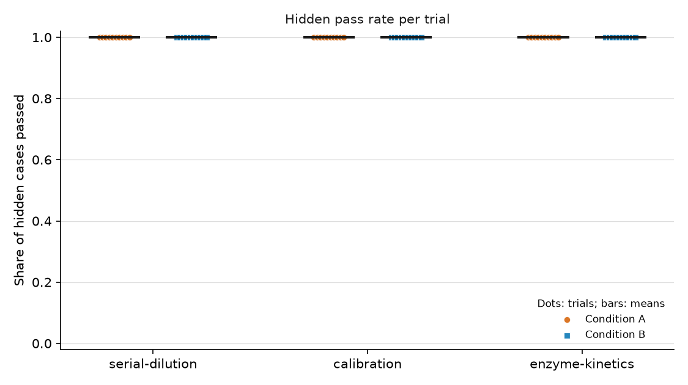
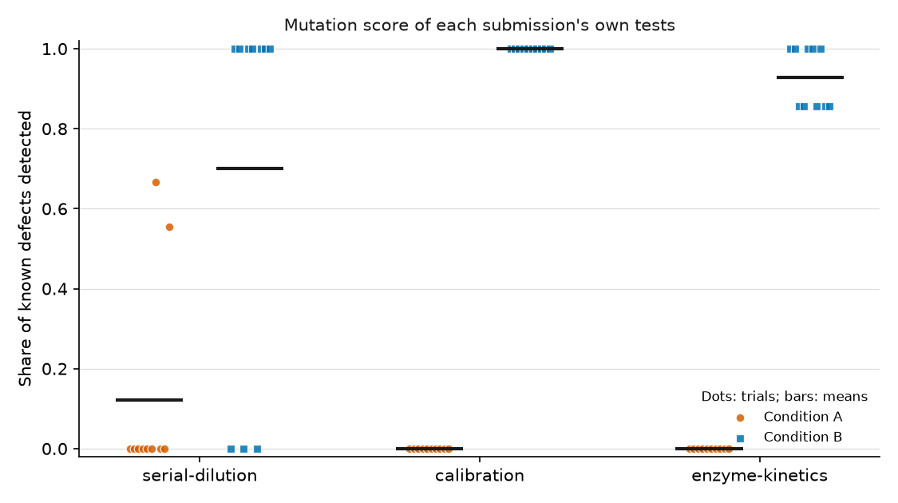
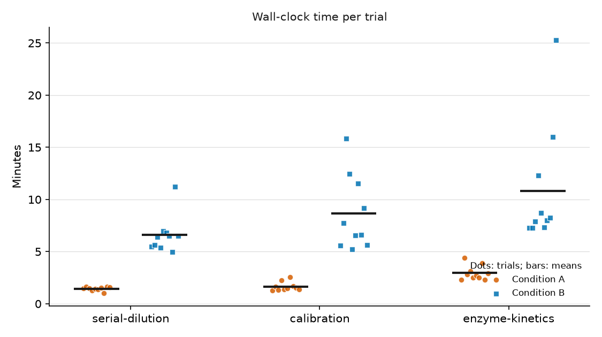

# Structured versus Unstructured AI-Assisted Scientific Programming: A Pre-registered Controlled Experiment with an AI Coding Agent

**John Ivanov**
Caltech CS/EE 143 special project (ResearchCode), November 2026

---

## Abstract

In research software, the costly errors of AI-generated code are often silent: wrong units,
inverted ratios, or unjustified statistics that still yield a number. ResearchCode, an
open-source educational project, teaches a structured workflow: specify, test, generate,
review, reproduce. We asked whether this workflow, packaged as a starter kit with explicit
instructions, makes an AI agent produce more reliable scientific code than unstructured
prompting.

In a pre-registered, randomised experiment, one agent (Claude Code 2.1.319, `claude-opus-5-5`,
effort `high`) solved three scientific tasks (serial dilution, calibration, enzyme kinetics)
in an isolated container. It worked unstructured (A) or with ResearchCode (B), in 10 trials
per task and condition (60 confirmatory trials). A hidden evaluator with 110 cases, which the
agent could not access, scored correctness.

Every submission passed every hidden evaluation case. The primary difference was 0.0 percentage points
(95% bootstrap CI [0, 0]; stratified permutation p = 1.0000), so the primary hypothesis was
not supported. This reflects a ceiling effect, not established equivalence.

Descriptively, Condition B produced large test suites with high mutation scores (mean 0.876
against 0.041) and lower lint density. It used about 4.3 times the wall-clock time and 3.7
times the output tokens. Post-hoc diagnostics found a misclassified security metric and a
fragile mutation measurement. A planned blinded maintainability review was not conducted.

---

## 1. Introduction

### 1.1 The problem: silent errors in AI-assisted scientific code

Researchers increasingly write analysis code with the help of AI coding assistants. The
benefit is speed. The risk is specific to science. The errors that matter most in research
code rarely crash a program: a dilution factor inverted, a unit converted twice, a normal
quantile used where a t quantile is required, or plates outside a countable range averaged
in anyway. Each still produces a plausible number. When a request leaves a scientific choice
unstated, an assistant makes one, often reasonably, rarely visibly, and sometimes wrongly.
Software-engineering practice offers known defences:

- writing down what "correct" means before coding;
- encoding independently derived known answers as tests;
- checking edge cases and invalid inputs;
- recording the environment so that results can be reproduced.

These practices cost time, and with an AI assistant they also cost interaction and tokens.

### 1.2 ResearchCode

ResearchCode is an open-source educational project, developed as a Caltech CS/EE 143 special
project, on using AI coding assistants responsibly in research. It consists of four parts:

- a website with guides;
- a scientific Python starter kit (uv, pytest, Hypothesis, Ruff, continuous integration,
  instructions for AI assistants, and run metadata);
- a worked growth-curve analysis application;
- the controlled evaluation reported here.

The workflow it teaches has five steps: *specify, test, generate, review, reproduce*. The
starter kit puts these steps into practice for a Python project.

### 1.3 What this study evaluates, and what it does not

This study evaluates the **workflow as packaged for an AI agent**: the starter kit copied
into the agent's workspace, plus a prompt that tells the agent to follow it. It does **not**
evaluate the ResearchCode website or its guides as educational material. No human
participants took part, and nothing here measures whether people who read the guides write
better code.

The research question, fixed before data collection, is:

> When the same AI coding agent, with the same model, tools, and limits, is given the same
> scientific programming task, does working within ResearchCode's structured workflow
> (starter kit, specification, tests, verification) produce more reliable scientific
> software than unstructured AI coding ("vibe coding")?

"More reliable" was operationalised as the share of a hidden test suite that a submission
passes (Section 4.1).

"Vibe coding" is the protocol's informal label for the comparison condition. In this study,
Condition A means exactly one thing: the agent receives the task statement, its public
examples, and a short prompt to implement the module (Section 3.1). The experiment does not
evaluate every practice that the term may describe.

---

## 2. Research Questions and Hypotheses

The hypotheses are reproduced from the pre-registered protocol [1] (section 1) without change.

- **H1 (primary, confirmatory).** The mean share of hidden evaluation cases passed differs
  between the structured condition (B) and the unstructured condition (A), averaged over tasks
  with equal weight. The direction we expect is B > A; the test is two-sided.

Secondary questions were declared exploratory, to be reported with uncertainty and without
hypothesis tests:

- **H2.** B handles invalid input and edge cases better (pass rates in those case categories).
- **H3.** B's own tests are better at detecting known defects (mutation score).
- **H4.** B takes more development effort (wall-clock time, and the messages and tokens
  recorded in Claude Code's session log).
- **H5.** The conditions differ in numerical accuracy, static security findings, and
  maintainability indicators.

The protocol committed to reporting results "whatever their direction, including results that
do not favour ResearchCode".

---

## 3. Experimental Design

### 3.1 Conditions

Both conditions used the same agent, model, configuration, container image, network access,
and time limit. Each trial was one Claude Code session in a new, clean workspace. The
treatment was the only difference.

| | Condition A: unstructured | Condition B: ResearchCode |
| --- | --- | --- |
| Workspace | `TASK.md` and `public_examples.json` only | The same two files, plus a copy of the ResearchCode starter kit [7] (`AGENTS.md`, `CLAUDE.md`, specification template, security checklist, uv/pytest/Hypothesis/Ruff configuration [12–15], an unrelated growth-rate example package with tests, and a run-metadata module) |
| Prompt | 44 words: implement the module in `TASK.md`; code may be written and run; no one is available to answer questions | The same text, plus explicit workflow steps (219 words in total) |
| Instructions about tests | None; tests are allowed but not requested | Write a specification from the template; write known-answer, edge-case, invalid-input, and property-based (Hypothesis) tests; run Ruff and pytest and fix every failure; summarise assumptions |

Each condition is defined by its workspace and prompt, both frozen [4]. Condition A is
therefore not a general model of unstructured AI-assisted coding.

Both prompts state that no human is available, so the agent should record its decisions and
continue. In Condition B this replaces the starter kit's instruction to stop and ask a human.
The protocol lists this adaptation as a threat to validity (Section 8).

### 3.2 Tasks

Three tasks were chosen for their different failure modes. A growth-rate task was
deliberately excluded, because the starter kit contains a worked growth-rate example and
would give Condition B part of a solution. Each task specifies a small Python module with a
fixed public interface [3], runnable with only the standard library, NumPy, and SciPy [16].

| Task (module) | Required interface | Main failure modes it exposes |
| --- | --- | --- |
| Serial dilution (`serial_dilution`) | `convert_volume`, `step_dilution_factor`, `cumulative_dilution_factors`, `estimate_cfu_per_ml`, `dilution_volumes` | Volume units (including two "micro" characters), inverted dilution ratios, out-of-range plates, inclusive bounds, input validation |
| Calibration (`calibration`) | `fit_calibration`, `inverse_predict` | Degrees of freedom, t versus normal quantiles, the replicate term in the standard error, clipping negative estimates, numerically unstable sums |
| Enzyme kinetics (`enzyme_kinetics`) | `fit_michaelis_menten`, `main(argv)` (CSV to JSON tool) | Linearised (biased) fitting, unidentifiable fits, mM/µM units, byte-order marks and blank lines in CSV files, overwriting results, partial output after errors |

### 3.3 Hidden evaluator

Correctness was measured only by a hidden evaluator. The agent never saw its cases, their
expected values, or their number, and the evaluator was separate from the agent's workspace.

It was **not**, however, independent of the project. It was developed within ResearchCode,
with AI assistance from the same model family that was evaluated, not by an external
research team. Its validation (below) was carried out by the project, and no external party
has validated it. Its design:

- **Expected values** were derived independently of the reference solutions: from exact
  rational arithmetic, closed-form mathematics, and, for the nonlinear fit, a separate
  one-dimensional profile minimisation.
- **Reference solutions** passed 100% of the hidden cases.
- **Deliberately defective variants** ("mutants") were used to validate the evaluator: every
  one of the 24 was detected by at least one case.
- **Isolation:** generated code ran only in a Docker sandbox with no network, a read-only file
  system, and limited resources.
- **Grading:** the sandbox observed outputs and the host graded them, so expected values never
  entered the sandbox.

The hidden cases, references, and mutants are kept in a private repository. Only aggregate
validation figures are public [5].

**Table 1.** Hidden cases per task and category (public aggregate figures).

| Task | known_answer | edge_case | invalid_input | numerical | reproducibility | integration | Total | Mutants |
| --- | --- | --- | --- | --- | --- | --- | --- | --- |
| Serial dilution | 17 | 11 | 23 | – | 2 | – | 53 | 9 |
| Calibration | 7 | 7 | 12 | 2 | 2 | – | 30 | 8 |
| Enzyme kinetics | 3 | 3 | 5 | 2 | 2 | 12 | 27 | 7 |
| **Total** | | | | | | | **110** | **24** |

Case scoring is binary: a case passes only if every check in it passes. Numeric checks have
default relative tolerances of 10⁻⁹ for closed-form results, 10⁻⁶ for confidence limits, and
10⁻⁵ for iteratively fitted parameters. If the module cannot be imported under the required
name, every case fails.

### 3.4 Agent configuration, environment, and isolation

| Setting | Value (both conditions) |
| --- | --- |
| Tool | Claude Code 2.1.319 |
| Model and effort | `claude-opus-5-5`, effort `high` |
| Tools | Default tool set without `WebSearch` and `WebFetch`; permission checks bypassed inside the container |
| Container | Non-root Docker container with Python 3.12, uv, and Node.js; 2 CPUs, 4 GB memory, 512 processes; a new home directory and an empty Claude configuration for every trial; only the trial's workspace mounted |
| Network | Internal network behind a filtering proxy that allowed only the model API, the OAuth token service, and the Python package index; GitHub and the rest of the web blocked |
| Time limit | 45 minutes per trial |
| Access | The experimenter's Claude Pro subscription token only; no API key; paid extra usage turned off; additional spending $0. Non-interactive use under a plan draws from the plan's limits [11] |

A trial was **invalid** only for infrastructure failures that are not the agent's behaviour.
Examples are API errors that end the session, a usage-limit interruption, a harness failure,
or a configuration that differs from the protocol. The agent's own failures, such as wrong
code, giving up, or reaching the time limit, were valid outcomes. An invalid trial was rerun
under the same identifier with a new attempt number, at most twice, from a new workspace.

### 3.5 Sample size, randomisation, and schedule

- **Confirmatory:** 10 trials per task × condition cell, 60 in total. The number was set by
  available effort, not by a power calculation, because no variance estimate existed. The
  protocol notes that ten per cell can detect only large differences.
- **Pilot:** 6 trials, one per cell, excluded from every confirmatory analysis.
- **Randomisation:** the schedule was generated from a fixed seed (20261111). The 60
  confirmatory trials form 10 blocks, each containing one trial of every cell in random
  order. Running in schedule order spreads any drift in the model service over both
  conditions.
- **Stopping rule:** collection could stop only at the end of a complete block and never
  because of results. All 60 trials were completed.

### 3.6 Pre-registration, freezing, and the change of execution mode

**What was frozen before trials began.** The protocol was written on 2026-11-11 (version 1.0)
and revised to version 1.4 by 2026-11-14, before any trial. The revisions:

- removed paid API use;
- moved the hidden evaluator to a private repository;
- stopped counting inherited starter-kit tests;
- fixed two harness defects found before the pilot [9, 10].

The design was then frozen in a freeze record, `FREEZE.json` [1]. It holds the SHA-256 hash of
every file that defines the experiment:

- the protocol, the machine-readable configuration, and the review rubric;
- the task statements and the condition prompts;
- the harness source code and the container definitions;
- the dependency lock file and the starter kit;
- every file of the private evaluator.

The protocol 1.4 record (`b910a7b7afd0a1fd`) states that it was made at 02:52:37 UTC on
2026-11-15. It was merged into the project's GitHub repository at 03:23:27 UTC, about six
minutes before the first pilot session began (03:29:52 UTC). That merge record is the only
third-party timestamp of the frozen design. **No external pre-registration registry was
used.** Pre-registration here therefore means a protocol and analysis plan fixed by hashes and
published in the project repository before data collection, not an entry in a public
registry [20].

**The change of execution mode.** Under **protocol 1.4**, the six pilot trials and the first
confirmatory trial (`serial-dilution--B--r01`) ran as manual, interactive sessions. A human
operator started and ended each session but did not guide the agent. No continuation message
was sent in any of them.

**Protocol 1.5** (2026-11-16; freeze record `f09fbb4872529faa`) ran the remaining 59
confirmatory trials unattended, with Claude Code's non-interactive mode, through a batch
runner. Everything else was unchanged: the prompts, model, effort, tools, container, time
limit, evaluator, schedule, and analysis. The runner refused to start if any credential other
than the subscription token was present. It stopped a session at once on any sign of an API
key, paid usage, the usage limit, or a configuration mismatch.

The amendment kept the interactive confirmatory trial in the primary analysis. It added an
exploratory analysis without that trial, reported separately. It was recorded in four ways:

- an entry dated 2026-11-16 in the protocol's amendment table (section 13);
- verbatim copies of the superseded version 1.4 protocol, configuration, and freeze record,
  kept for audit;
- a new freeze record, which states that it was made at 22:38:43 UTC on 2026-11-16, before
  the engineering run and before any unattended confirmatory trial;
- the freeze hash it matched, stored in each trial's evaluation record.

These timestamps are recorded by the project itself. The amendment was committed to the
local repository on 2026-11-18 at 23:54 UTC, after the first unattended confirmatory trial
had run, and was first published on GitHub together with this report, after data collection
had ended. **Protocol 1.5 therefore has no third-party timestamp that predates the first
unattended trial.**

Before the first unattended confirmatory trial, one engineering validation run (`calibration--A--e01`) tested the path
end to end. It was stored separately and analysed nowhere.

### 3.7 Data collection

Data collection ran from 2026-11-15 (pilot) to 2026-11-21 (UTC) [2]. Two infrastructure incidents
produced invalid attempts, both rerun under the pre-registered rule:

- **`serial-dilution--B--r05`, attempt 1:** stopped by the batch runner when the subscription's
  five-hour usage limit was reached.
- **`calibration--A--r09`, attempt 1:** the host laptop slept with its lid closed on battery;
  API connections dropped (`ECONNRESET`) after 10 retries; the trial was classified as needing
  review and then recorded as invalid.

Neither attempt was evaluated. Both are archived, and both reruns (attempt 2) completed
normally.

A third trial, `serial-dilution--B--r09`, ran during the same sleep and recovered from 9 API
retries. It completed normally and is valid under the protocol. Before analysis, an
outcome-blind audit checked every confirmatory trial:

- **Trials:** all 60 were valid and matched the schedule;
- **Configuration:** every trial used the frozen model, effort, tool version, and permission
  mode, and subscription authentication;
- **Evaluation:** every evaluation record was complete, with no evaluation error and no time
  limit reached.

---

## 4. Outcome Measures and Statistical Methods

### 4.1 Primary measure

The **hidden pass rate** is the share of a task's hidden cases that a submission passes (0 to
1). Cases are weighted equally within a task, and tasks equally in the comparison. The primary
estimand is

  Δ = mean over tasks of (mean pass rate in B − mean pass rate in A).

### 4.2 Pre-registered analysis

All of the following were fixed in protocol section 11 and implemented in frozen code. The
analysis seed was 20261112.

- **Uncertainty:** a 95% percentile bootstrap confidence interval [17] for Δ, resampling trials
  with replacement within each task × condition cell, with 10,000 resamples.
- **Test of H1:** a stratified permutation test [18] that shuffles condition labels within each
  task, with 10,000 permutations. It is two-sided, with α = 0.05, and reports
  p = (k + 1)/(R + 1). Here R is the number of permutations, and k the number whose |Δ*| is at
  least the observed |Δ|. It was required to be reported only if every cell had at least 5
  valid trials (all had 10). **It is the only hypothesis test in the study.**
- **Per-task differences,** with bootstrap intervals (descriptive).
- **Sensitivity analysis:** the same estimand computed on the *category-balanced* pass rate,
  the unweighted mean of a trial's pass rates over the case categories present in its task.
  It addresses the unequal category sizes in Table 1 and is descriptive.
- **Secondary metrics,** described as descriptive, with no p-values (Table 2).
- **Exploratory (protocol 1.5):** the primary estimand without the one interactively run
  confirmatory trial, labelled and with no test.

**Table 2.** Secondary measures (protocol section 5.2).

| Measure | Definition |
| --- | --- |
| Category pass rates | Hidden pass rate within each case category (H2 uses `edge_case` and `invalid_input`) |
| Mutation score | Share of the task's 7–9 mutants detected by the submission's own tests (mutation analysis [19]) |
| Own tests | Number of tests the submission created or adapted, excluding tests inherited unchanged from the starter kit |
| Numerical accuracy | Median relative error over numeric fields in known-answer cases |
| Static security findings | Ruff [12] `S` (flake8-bandit) findings in non-test code, under a fixed rule set |
| Lint density | Ruff findings per 100 non-blank, non-comment lines of non-test code, same fixed rule set (line length excluded) |
| Dependency hygiene | Runtime dependencies outside the standard library, NumPy, and SciPy |
| Development effort | Session wall-clock time; assistant messages, operator messages, and tokens as recorded in Claude Code's session log (protocol wording, unchanged from version 1.4 to 1.5) |

**How the mutation score works.** The submission's own tests are run three ways in the
sandbox:

1. against its own code;
2. against the reference solution, with its module replaced. Tests that do not pass here are
   excluded as invalid;
3. against each mutant. A mutant is detected if any valid test fails or errors.

A submission without valid tests scores 0. Tests written by a submission never count as
evidence of its correctness.

**A difference between protocol and implementation.** For secondary metrics, protocol
section 11 calls for "medians and means with bootstrap CIs per condition and task". The frozen
implementation reports means and medians per condition and task. Its bootstrap intervals,
however, are for the **B − A difference**, not for each condition's mean or median. The
results below follow the frozen implementation, which was not changed.

### 4.3 Analyses that were not pre-registered

Section 6 reports measurement diagnostics that were found **after** the analysis had run and
its results had been unblinded. They are labelled post hoc. They do not alter any reported
statistic.

A blinded human maintainability review (protocol section 5.3; rubric [6]) was planned. The project owner
decided not to conduct it, for reasons of time and resources, before viewing the comparative
results. It is therefore absent (Section 8).

---

## 5. Results

The analysis ran once, on 2026-11-22, with the unchanged pre-registered command [8]. All 60
confirmatory trials were found and analysed, and none was excluded. Each cell had 10 valid
trials (planned 60, achieved 60). Fifty-nine trials ran unattended and one interactively.

### 5.1 Primary outcome: hidden-test correctness

**Every one of the 60 submissions passed every hidden case.** No submission failed to import.

**Table 3.** Hidden pass rate (n = 10 per cell).

| Task | A: mean (median) | B: mean (median) | B − A | 95% bootstrap CI |
| --- | --- | --- | --- | --- |
| Serial dilution | 1.000 (1.000) | 1.000 (1.000) | 0.000 | [0.000, 0.000] |
| Calibration | 1.000 (1.000) | 1.000 (1.000) | 0.000 | [0.000, 0.000] |
| Enzyme kinetics | 1.000 (1.000) | 1.000 (1.000) | 0.000 | [0.000, 0.000] |
| **Mean over tasks** | **100.0%** | **100.0%** | **0.0 pp** | **[0.0, 0.0] pp** |

The stratified permutation test gave **p = 1.0000** (two-sided). The difference is not
significant at α = 0.05, and **H1 is not supported.**

**Interpreting the null result.** The outcome sits at the ceiling of the measure: the
standard deviation was 0 in every cell. Three consequences follow.

1. **The p-value.** Every permutation of identical values reproduces Δ* = 0. All 10,000
   permutations are therefore "at least as extreme", and p = 10,001/10,001 = 1. This shows
   that the test could not detect anything, not that the conditions are alike in general.
2. **The interval.** A percentile bootstrap resamples observed values. When all values are
   equal, every resample has Δ* = 0, and the interval collapses to [0, 0]. **This degenerate
   interval reflects zero observed variation, not precise knowledge of the effect.** It does
   not establish equivalence, and it does not bound the difference that harder tasks or other
   agents might show.
3. **What can be said.** With this agent and these tasks, both workflows produced code that
   the evaluator could not fault, although in validation it caught every deliberate defect.

*Figure 1. Hidden pass rate per trial, by task and condition. Each dot is a trial and each bar
a cell mean. All 60 values equal 1.0. (Generated by the frozen analysis.)*

### 5.2 Category-level correctness (H2) and sensitivity analysis

Every case category had a pass rate of 1.000 in both conditions:

- known answer, edge case, invalid input, and reproducibility: B − A = 0.000, CI [0.000, 0.000];
- numerical and integration: also 1.000 in both conditions. They have no mean-over-tasks
  difference because they do not occur in all three tasks (Table 1). Their per-task
  differences are 0.

The category-balanced sensitivity analysis gave 1.000 in both conditions (Δ = 0.000,
CI [0.000, 0.000]). The data therefore give no support to H2. As with H1, this is a ceiling
observation.

### 5.3 Exploratory analysis without the interactive trial

Without `serial-dilution--B--r01` (59 trials, with 9 trials in that cell), the exploratory
estimate was Δ = 0.000, with CI [0.000, 0.000]. No test was reported. Removing the one
interactively run confirmatory trial did not change the observed primary estimate. This
analysis does not show that execution mode had no causal effect on the agent's behaviour: one
trial cannot support such a conclusion, and the outcome was at its ceiling in any case.

### 5.4 Secondary measures (descriptive)

Table 4 gives the frozen output: pooled means and medians over the 30 trials per condition,
and the mean-over-tasks difference with its 95% bootstrap interval. These intervals describe
uncertainty. They are not hypothesis tests, and they are not adjusted for multiple
comparisons. No values were missing for any metric.

**Table 4.** Secondary measures (n = 30 per condition).

| Measure | A: mean (median) | B: mean (median) | B − A [95% CI] |
| --- | --- | --- | --- |
| Mutation score of own tests | 0.041 (0.000) | 0.876 (1.000) | +0.835 [0.723, 0.935] |
| Own tests collected | 0.4 (0) | 132.6 (102.5) | +132.2 [126.1, 138.4] |
| Wall-clock minutes | 2.02 (1.64) | 8.69 (7.27) | +6.67 [5.43, 8.19] |
| Assistant messages | 8.1 (8) | 21.0 (20) | +12.9 [10.8, 15.0] |
| Output tokens | 12,281 (10,938.5) | 45,225 (43,671) | +32,944 [30,137, 35,960] |
| Lint findings per 100 lines | 3.20 (2.03) | 0.42 (0.00) | −2.78 [−3.53, −2.09] |
| "Static security findings" (see Section 6.1) | 0.90 (0) | 0.00 (0) | −0.90 [−1.20, −0.63] |
| Median relative error, known-answer cases | < 2 × 10⁻⁹ | < 2 × 10⁻⁹ | ≈ 0 (see below) |
| Extra or undeclared dependencies | 0 | 0 | 0 |
| Category-balanced pass rate | 1.000 | 1.000 | 0.000 [0.000, 0.000] |

**Table 5.** Selected secondary measures by task (A → B; B − A with 95% CI).

| Measure | Serial dilution | Calibration | Enzyme kinetics |
| --- | --- | --- | --- |
| Mutation score | 0.122 → 0.700; +0.578 [0.244, 0.889] | 0.000 → 1.000; +1.000 [1.000, 1.000] | 0.000 → 0.929; +0.929 [0.886, 0.971] |
| Own tests collected | 1.2 → 221.9; +220.7 | 0.0 → 100.4; +100.4 | 0.0 → 75.5; +75.5 |
| Wall-clock minutes | 1.44 → 6.59; +5.15 [4.32, 6.35] | 1.66 → 8.64; +6.98 [5.01, 9.24] | 2.95 → 10.83; +7.88 [4.98, 11.74] |
| Output tokens | 9,818 → 41,140 | 10,020 → 44,800 | 17,004 → 49,736 |
| Assistant messages | 7.0 → 15.4 | 7.4 → 21.0 | 9.9 → 26.5 |
| Lint per 100 lines | 0.71 → 0.00 | 2.85 → 0.00 | 6.04 → 1.26 |

**Testing practice (H3).** Condition A wrote tests in only 2 of 30 trials, both in serial
dilution (6 tests each). Condition B wrote tests in all 30. Mutation scores were above 0 in 2
A trials and 27 B trials. All 30 B suites passed against their own code. The three B trials
with a mutation score of 0 are examined in Section 6.2.

The size of the gap mostly reflects the treatment's explicit instruction to write tests.
Condition A was neither asked to write tests nor prevented from doing so.

*Figure 2. Mutation score of each submission's own tests, by task and condition. Each dot is a
trial and each bar a cell mean. (Generated by the frozen analysis.)*

**Development effort (H4).** Condition B used about 4.3 times the wall-clock time (8.69 against
2.02 minutes), 3.7 times the output tokens, and 2.6 times the assistant messages. These figures
are pooled means. The longest session lasted 25.3 minutes, and no trial reached the 45-minute
limit.

Wall-clock time is the session's measured running time. A period during which the host was
asleep is not counted, which matters for one trial (Section 3.7).

The protocol pre-registered development effort (H4) as wall-clock time plus "assistant
messages, operator messages, and tokens" recorded in Claude Code's session log, unchanged from
version 1.4 to 1.5. The frozen analysis reports wall-clock time, assistant messages, and
**output** tokens. It does not summarise operator messages (exactly one, the prompt, in every
trial) or the input and cache tokens stored in the trial records. The protocol does not
specify which kind of token; reporting output tokens is the frozen implementation's choice,
and no further token analysis is added here.

*Figure 3. Wall-clock minutes per trial. (Generated by the frozen analysis.)*

**Code quality indicators (H5).**

- **Lint density** was lower in B (0.42 against 3.20 findings per 100 lines). A's findings were
  mostly `B905` (`zip()` without `strict`), naming rules (`N803`, `N806`), and pathlib rules
  (`PTH`). B's were naming rules only. B's workflow ran Ruff, so this difference is partly a
  direct consequence of the treatment.
- **Numerical accuracy:** median relative errors were at most 1.8 × 10⁻⁹ in every trial (22 of
  60 were exactly 0). The descriptive difference (about −7 × 10⁻¹¹) is far below the
  evaluator's tolerances and has no practical meaning.
- **Dependencies:** no submission had extra dependencies.
- **Security findings:** the reported difference is not valid (Section 6.1).
- **Maintainability:** not measured (Section 8).

### 5.5 The trade-off

On these tasks, the structured workflow did not change measured correctness, but it changed
the artifacts: B's submissions came with specifications, large and mostly reference-valid test
suites that detect most seeded defects, and cleaner lint profiles. The cost was about four
times the session time and output tokens. Whether the tests would pay for themselves later,
for example by catching a regression when the code is modified, was not measured.

---

## 6. Post-Hoc Measurement Diagnostics

The two problems below were found **after** the pre-registered analysis had run and after
unblinding. They were documented in the research log [2]. They do **not** change any reported
statistic: the frozen output, scores, and records are unchanged, and no trial was excluded.

### 6.1 The security metric counts simplification rules

Protocol section 5.2 defines static security findings as Ruff `S` (flake8-bandit) rules. The
frozen implementation selects every Ruff code whose identifier *starts with* `S`, and so also
counts the `SIM` (flake8-simplify) rules in the fixed rule set.

Every finding counted as "security" was a `SIM` code. Condition A had 27 such findings in 12 of
30 trials: SIM105 9, SIM115 8, SIM101 5, SIM102 3, SIM108 1, and SIM300 1. Condition B had none.

Counting only codes of the form `S` followed by digits, **both conditions had zero security
findings**. The reported −0.90 difference is therefore a difference in style, not in security.
**No claim that either condition improved security is supported.** The `SIM` findings are also
counted, correctly, in lint density.

### 6.2 Mutation validity collapsed in three serial-dilution B trials

**Observed** (from the frozen records and files). In `serial-dilution--B--r01`, `r04`, and
`r07`:

- **Own tests:** 220, 229, and 252 tests passed against the submission's own code.
- **Against the reference:** 0 tests were valid, so the mutation score was 0.
- **The extra import:** each main test file imports, at module level, a custom exception class
  defined by the submission (`InputTypeError` or `InvalidTypeError`). Each class subclasses
  both `TypeError` and `ValueError`, which satisfies the task statement. The reference does not
  define it.
- **The second file:** the property-test file of each suite (14–17 test functions) does not
  import the class.
- **No other difference:** the module layout and pytest configuration match the seven
  serial-dilution B trials that scored 1.0. Those import no name from the module beyond the
  five required functions.

**Strongly supported mechanism, not directly observed.**

- **The chain:** with the reference substituted, the import cannot be resolved. pytest's default
  is to stop the whole session when any test file fails to load ("Interrupted: 1 error during
  collection"), so no test in either file runs. The evaluator runs the entire suite in one
  session, without `--continue-on-collection-errors` [14].
- **The evidence:** static inspection; a check that the reference defines no such name; and a
  synthetic reproduction in the sandbox image (pytest 9.2.0) that used no submission or
  reference code.
- **The limit:** the original reference-run output was not retained, and the suites were not
  rerun.

**Unknown.** How much of each suite would have been compatible with the reference, and how many
defects it would have detected.

**Interpretation.** These three zeros record a measurement failure. They are not evidence of
ineffective tests. The failure can only lower Condition B's scores. The reported values
(serial-dilution B mean 0.700; overall Δ +0.835) remain the pre-registered result.

**Post-hoc scenario bound.** If each affected trial had scored 1.0, the serial-dilution
difference would be +0.878, and the overall difference **+0.9354**. This is a bound under one
hypothetical scenario. It is **not** a corrected estimate and not a confidence interval.

It coincides numerically with the upper limit of the reported interval (0.935), but the two
quantities mean different things.

The conclusion that B's tests detect far more defects than A's does not depend on these
trials, because A wrote tests in only 2 of 30 trials.

**A related case, and the broader fragility.** In one enzyme-kinetics trial, one test imports
a submodule that does not exist after the reference is substituted. The import sits inside a
test function, so only that test was lost (58 of 62 valid). Across trials that kept valid tests,
48%–94% of collected tests were valid; the reasons for the other exclusions were not
investigated.

Reference-based validation is all-or-nothing per test, and one module-level import can
invalidate a whole suite. Excluding tests coupled to a particular implementation is also what
the rule is for: tests that depend on a custom exception type are less portable. This
investigation does not show that every excluded test would have passed against a compatible
reference.

---

## 7. Discussion

### 7.1 What the experiment supports

For one agent configuration (Claude Code 2.1.319, `claude-opus-5-5`, high effort) on three small,
well-specified scientific tasks:

- **Correctness:** unstructured prompting already produced code that passed every hidden
  evaluation case, so the structured workflow could not improve measured correctness, and it
  did not.
- **Artifacts:** every B trial added a document under `docs/`, as the specification step
  requires, and wrote a large test suite; no A trial added such a document, and 2 of 30 wrote
  tests.
- **Cost:** about four times the session time and output tokens (Section 5.4).

Because conditions were randomised within tasks, and everything except the treatment was held
fixed, these differences can be attributed to the treatment **within this setup**.

### 7.2 Why more testing did not yield higher measured correctness

The simplest explanation is the ceiling. The agent's code passed every hidden case without any
workflow, so there were no errors left, of the kinds the evaluator detects, for tests to
prevent.

This experiment cannot tell which of the following is true:

- the agent met the task statements in both conditions without needing tests;
- B's tests caught errors that A never made;
- B's tests caught its own intermediate mistakes.

Session transcripts might show intermediate failures, but they were not analysed. The
mutation score shows that B's tests *could* detect realistic defects. It does not show that
they *did* change the delivered code.

### 7.3 Implications for scientists using AI coding assistants

These results do not show that structured workflows are unnecessary. They show that, on small,
precisely specified tasks, a strong current agent may not need one to pass every hidden
evaluation case. The value usually claimed for tests and specifications lies in ambiguous or
large tasks, later modifications, and review by others, none of which was measured here.

For a researcher, asking an assistant to specify and test leaves a durable verification
record at a measurable cost in time and tokens. On simple tasks it may not change the
immediate answer, and a perfect hidden-test score on easy tasks says little about harder ones.

### 7.4 What the experiment does not support

The results do not show that ResearchCode helps human researchers, that its website teaches
effectively, or that either workflow is more reliable on harder, longer, or less specified
problems, or with other models or tools. Nor do they show a security or maintainability
difference: true security findings were zero in both conditions (Section 6.1), and
maintainability was not measured.

---

## 8. Threats to Validity and Limitations

- **Ceiling effect.** The primary metric had no variance, so the experiment had no ability to
  distinguish the conditions on correctness. This is the central limitation.
- **Scope.** Three small tasks, one agent, one model and tool version, and one effort level.
  Results apply to this agent, model, prompt pair, and task set.
- **Sample size.** Ten trials per cell can show only large differences. This mattered less than
  the ceiling, but it would matter for less extreme outcomes.
- **Bundled treatment.** Condition B combines the starter kit, a longer prompt, and explicit
  instructions. Their contributions cannot be separated. The "stop and ask a human"
  instruction was replaced by "record your decision", which changes the treatment.
- **Designer and evaluator bias.** The tasks, hidden cases, evaluator, and treatment were
  designed by the same project, with help from the same AI model family that was evaluated
  (Section 3.3). The hidden cases were written from the task statements and frozen before any
  trial, but no external team built or validated the evaluator, and a richer or more
  adversarial case set might have separated the conditions.
- **Measurement defects found after unblinding.**
  - **The security metric** counts `SIM` rules (Section 6.1).
  - **Mutation validity** collapsed in three B trials (Section 6.2); the reported mutation
    difference is conservative with respect to B.
  - **Secondary confidence intervals:** the written protocol asks for intervals per condition;
    the frozen code gives intervals for the difference (Section 4.2).
- **Execution-mode amendment.** One confirmatory trial ran interactively under protocol 1.4,
  and 59 ran unattended under 1.5. Excluding it leaves the observed estimate unchanged, which
  cannot rule out an effect of execution mode (Section 5.3).
- **Infrastructure incidents.** Two invalid attempts (a usage limit, and an API disconnection
  during host sleep) were rerun under the pre-registered rule (Section 3.7). One valid trial
  ran mostly during host sleep with recovered API retries; its measured time excludes the
  sleep. Three valid trials completed while the subscription showed a usage-limit warning, and
  the protocol notes that sessions near a limit could behave differently.
- **Omitted maintainability review: a protocol deviation.** The blinded human review was not
  conducted, for reasons of time and resources decided before the comparative results were
  viewed (Section 4.3). No human or AI reviewer scored any submission, so maintainability, as
  defined by the rubric, is unmeasured. Review packets were generated and
  a metadata leak in them was corrected, but they were never used.
- **Partial exposure to outcomes during collection.** The batch journal records each trial's
  hidden pass rate. While investigating the usage-limit incident, the AI assistant operating
  the investigation saw these values for schedule positions 8–32. Separately, the engineering
  run's value was reported to the project owner. No validity decision depended on a score: the
  invalid attempts were never evaluated, and all other validity was set automatically.
- **Agent, not human, participants.** Human researchers may use either workflow differently.
  Web access was blocked in both conditions to protect the evaluator, unlike many real
  workflows.
- **Self-reported effort.** Message and token counts come from Claude Code's own logs. They are
  not independent measurements.
- **Publication deviation: three commitments not fulfilled.** The protocol committed to
  releasing the evaluator after data collection (section 3), publishing the pilot results
  separately (section 6), and publishing every attempt, including invalid ones (section 10).
  After the analysis and unblinding, the project owner decided not to fulfil these commitments.
  This deviation from the publication plan was not pre-registered. It is not an amendment to
  the methods: the protocol, the analysis, and every recorded outcome are unchanged. The
  withheld material (Section 10) limits independent replication and auditing. Others cannot
  check the evaluator against its frozen hashes, rerun the hidden evaluation, or recompute
  per-trial scores.

---

## 9. Conclusion

In a pre-registered, randomised comparison of 60 trials, an AI coding agent produced code that
passed every hidden evaluation case on three scientific tasks, with and without ResearchCode's
structured workflow. **The primary hypothesis, that hidden-test pass rates differ between the
conditions, was not supported** (0.0 percentage points; p = 1.0000). Because the outcome was
at its ceiling, this is not evidence that the workflows are equivalent in general. The
structured workflow produced specifications and large test suites that detected most seeded
defects, at about four times the session time and output tokens. No security or
maintainability difference can be claimed.

Untested directions follow: harder or deliberately ambiguous tasks that avoid the ceiling;
outcomes that measure later value, such as modifying code or catching regressions; the
planned blinded maintainability review; separating the starter kit from the instructions;
other models and tools; and studies with human researchers. An evaluator that judges test
validity per file, and keeps the reference run's output, would make the mutation measure more
robust.

---

## 10. Reproducibility and Availability

- **Frozen configuration.** Freeze record `f09fbb4872529faa` (protocol 1.5) covers the
  protocol, configuration, tasks, prompts, harness, container definitions, dependency lock
  file, starter kit, and the hashes of the private evaluator files. The superseded protocol 1.4
  record (`b910a7b7afd0a1fd`) is kept with the protocol, configuration, and freeze record of
  that version. Before and after the analysis, `rc-exp freeze --check --require-private`
  confirmed that every frozen file matched.
- **Reproducing the analysis.** From the `experiments/` directory, with the collected results
  present: `uv run rc-exp analyze --kind genuine`. The analysis is deterministic (seed
  20261112) and refuses to overwrite existing output. New *trials* would need the same tool and
  model versions and still would not reproduce these sessions exactly, because model outputs
  are nondeterministic and the service can change.
- **What is released.** The ResearchCode repository (github.com/johnivanov04/ResearchCode) is
  public. It contains:
  - the protocol (version 1.5, with its amendment table), and the superseded version 1.4
    protocol, configuration, and freeze record;
  - the tasks, prompts, harness (including the batch runner), fixture evaluator, and aggregate
    evaluator validation;
  - the research log and this report;
  - an aggregate summary of the analysis output, `experiments/docs/aggregate-results.json`:
    means, medians, and intervals per condition and task, and counts, with no per-trial rows;
  - the three figures in Section 5. Each plots every confirmatory trial's value as an
    unlabelled dot, by task and condition. Apart from the few individual trials named in
    Section 6.2, these dots are the only trial-level values released.

  The project website shows the same aggregate results.
- **What is withheld: a deviation from the publication plan.** The protocol committed to
  releasing three kinds of material: the evaluator after data collection (section 3), the
  pilot results (section 6), and every attempt (section 10). After the analysis and
  unblinding, the project owner decided not to release them. The following are withheld:
  - the hidden evaluator: cases, expected values, reference solutions, and mutants;
  - the full pilot results;
  - the confirmatory trials' records, submissions, and session logs, and the full analysis
    output with its per-trial rows;
  - the two invalid attempts;
  - the review packets, the blinding key, credentials, and backups.

  Per-trial evaluation records list hidden-case identifiers and per-case details. The
  evaluator's file hashes remain in the freeze record. The deviation limits independent
  replication and auditing (Section 8). It changes no method, analysis, or result.
---

## 11. AI Assistance Statement

As the project's own research log records, Claude Code (the same model family that was
evaluated) wrote:

- the protocol drafts, task statements, hidden cases and their derivations, reference
  solutions, defective variants, and harness;
- the analysis code and the audits;
- a draft of this report.

The project owner set the research question and constraints, approved each protocol change,
started every data-collection batch, and made every validity decision that required judgement.
The protocol lists the shared model family as a threat to validity.

---

## 12. References

**Project materials** (repository paths are relative to the ResearchCode repository):

1. ResearchCode. *Pre-registered protocol: structured vs unstructured AI-assisted scientific
   coding*, version 1.5. `experiments/docs/PROTOCOL.md`; machine-readable configuration in
   `experiments/experiment.json`; freeze record in `experiments/FREEZE.json`.
2. ResearchCode. *Research log*. `experiments/docs/RESEARCH_LOG.md`.
3. ResearchCode. *Task statements*. `experiments/tasks/{serial-dilution,calibration,enzyme-kinetics}/TASK.md`.
4. ResearchCode. *Condition prompts*. `experiments/conditions/`.
5. ResearchCode. *Evaluator validation (aggregate)*. `experiments/docs/evaluator-validation.json`.
6. ResearchCode. *Blinded maintainability review rubric*. `experiments/docs/REVIEW_RUBRIC.md`.
7. ResearchCode. *Scientific Python starter kit*. `scientific-starter/`.
8. ResearchCode. *Genuine analysis output* (not public): `experiments/results/analysis/genuine/report.md`, `analysis.json`, and `figures/`. Aggregate summary (public): `experiments/docs/aggregate-results.json`.

**Software and documentation used in the study:**

9. Anthropic. Claude Code documentation, network configuration: code.claude.com/docs/en/network-config (consulted for protocol 1.3).
10. Anthropic. Claude Code issue #46259, github.com/anthropics/claude-code/issues/46259 (first-run setup with a token; consulted for protocol 1.4).
11. Anthropic Help Center. "Use the Claude Agent SDK with your Claude plan" (update of 2026-10-07, which states that `claude -p` signed in with a Claude plan draws from the subscription's limits). https://support.claude.com/en/articles/15036540-use-the-claude-agent-sdk-with-your-claude-plan
12. Astral. Ruff (Python linter), docs.astral.sh/ruff; rule families flake8-bandit (`S`) and flake8-simplify (`SIM`).
13. Astral. uv (Python package and project manager), docs.astral.sh/uv.
14. pytest, docs.pytest.org (including the `--continue-on-collection-errors` option).
15. Hypothesis (property-based testing for Python), hypothesis.readthedocs.io.
16. NumPy, numpy.org; SciPy, scipy.org.

**Methodological background** (cited for the general methods; the analysis itself follows the
frozen protocol and code):

17. Efron, B., & Tibshirani, R. J. (1993). *An Introduction to the Bootstrap*. Springer US.
    https://doi.org/10.1007/978-1-4899-4541-9
18. Good, P. (2005). *Permutation, Parametric and Bootstrap Tests of Hypotheses* (3rd ed.).
    Springer Series in Statistics. Springer. https://doi.org/10.1007/b138696
19. Jia, Y., & Harman, M. (2011). An analysis and survey of the development of mutation testing.
    *IEEE Transactions on Software Engineering*, 37(5), 649–678. https://doi.org/10.1109/TSE.2010.62
20. Nosek, B. A., Ebersole, C. R., DeHaven, A. C., & Mellor, D. T. (2018). The preregistration
    revolution. *Proceedings of the National Academy of Sciences*, 115(11), 2600–2606.
    https://doi.org/10.1073/pnas.1708274114
