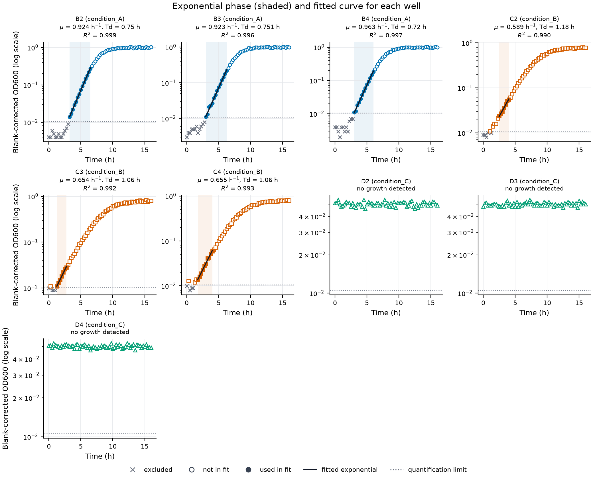
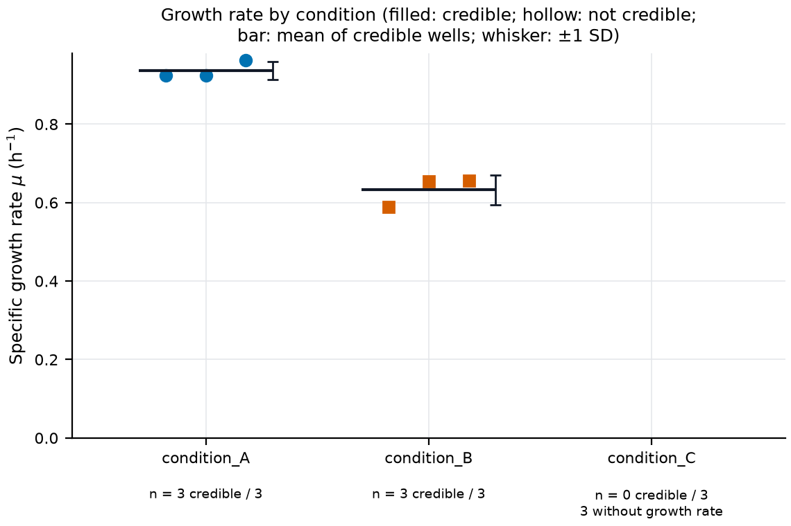

# growth-analysis

Estimate **specific growth rates** and **doubling times** of bacterial cultures from
optical density (OD600) time courses, such as microplate reader exports. For every well,
the tool finds the exponential growth phase, fits a straight line to ln(OD) over it,
checks whether the fit is credible, and plots the result so that a person can check it.
It then summarises replicate wells by condition.

This is the worked scientific demonstration of
[ResearchCode](https://github.com/johnivanov04/ResearchCode) (Phase 3), a Caltech CS/EE 143
special project. It was built from the project's
[scientific Python starter kit](https://github.com/johnivanov04/ResearchCode/tree/main/scientific-starter) to show how a researcher can use a
specification, tests, and run metadata to produce analysis code they can trust.

> **All bundled data are synthetic.** The sample files in `data/sample/` and the example
> results in `docs/example-output/` were generated from mathematical models with known
> parameters. They are not measurements and support no biological conclusion.

## Contents

- [Quick start](#quick-start)
- [Input format](#input-format)
- [The method](#the-method)
- [Outputs](#outputs)
- [Example results (synthetic)](#example-results-synthetic)
- [Options](#options)
- [How the results were validated](#how-the-results-were-validated)
- [Reproducibility](#reproducibility)
- [Assumptions and limitations](#assumptions-and-limitations)
- [Extending the application](#extending-the-application)
- [How this project was built from the starter kit](#how-this-project-was-built-from-the-starter-kit)
- [Troubleshooting](#troubleshooting)

## Quick start

Install [uv](https://docs.astral.sh/uv/getting-started/installation/) once per computer;
it also installs Python 3.12 or later if needed. Get the code (this project lives in the
ResearchCode repository; it is not published as a separate package):

```bash
git clone --depth 1 https://github.com/johnivanov04/ResearchCode.git
cd ResearchCode/growth-analysis
```

Then, from this directory:

```bash
uv sync --locked             # install the exact versions in uv.lock
uv run growth-analyze --input data/sample/synthetic_plate.csv --output results/sample
```

This analyses the synthetic sample plate, prints a summary table, and writes tables,
figures, and run metadata to `results/sample/`. Running it again into the same folder
fails on purpose instead of overwriting the earlier results; add `--overwrite` if you mean
it.

To analyse your own data, export it in the [input format](#input-format) and run:

```bash
uv run growth-analyze --input path/to/plate.csv --output results/plate1
```

Then **look at `figures/exponential_fits.png`** before using any number.

Checks for developers (the same as CI):

```bash
uv run pytest                # tests, including property-based and validation tests
uv run ruff check .          # lint, including security rules
uv run ruff format --check . # formatting
uv build                     # build the package
```

## Input format

A CSV file with a header row and one row per reading ("long" format):

```csv
well,condition,time_min,od600
A1,blank,0,0.040
B2,condition_A,0,0.044
A1,blank,15,0.041
B2,condition_A,15,0.044
```

| Column | Meaning |
| ------ | ------- |
| `well` | Identifies one culture (for example a plate well). |
| `condition` | Experimental condition. Wells with the same condition are replicates. Blank (medium-only) wells use the condition `blank` (change with `--blank-label`). |
| `time_h`, `time_min`, or `time_s` | Time since the start, in the unit named by the column. Exactly one of these must be present; a column called just `time` is rejected because its unit is ambiguous. |
| `od600` | Optical density as exported by the instrument (raw, including the blank). If your values are already blank-corrected, use `--blank-method none`. |

Other columns are allowed and ignored (they are listed in `results.json`). Rows may be in
any order across wells, but within a well, times must increase.

The file is validated before any analysis, and **every problem is reported together with
its line number**: missing columns, empty cells, values that are not numbers, NaN or
infinity, rows with the wrong number of fields, duplicate measurements (the same well at
the same time), times out of order, and a well listed under two conditions. Nothing is
dropped, repaired, or guessed. Readings at or below the blank are valid measurements: they
are kept, excluded from fitting with a recorded reason, and counted.

To convert a plate-reader "wide" export (one column per well), reshape it so that each
reading is one row, and add the condition of each well from your plate map.

## The method

The full specification, including every edge case, is
[docs/spec-growth-curve.md](docs/spec-growth-curve.md). In short:

1. **Blank correction.** Subtract the mean of all blank-well readings: x = OD − blank.
2. **Quantification limit.** Readings with x below max(0.005, 10 × SD of the blank
   readings) are excluded from fitting. On a log scale, the noise in ln x is roughly
   SD / x, so readings close to the blank are dominated by noise.
3. **Log transform.** During exponential growth, OD(t) = OD₀ e^{μt}, so
   ln OD(t) = ln OD₀ + μt is a straight line with slope μ.
4. **Find the exponential phase.** Fit a least-squares line to every window of five
   consecutive valid readings. Start from the steepest window and extend over neighbouring
   windows whose slope is at least 80% of the steepest. The exponential phase is every
   reading in that run of windows.
5. **Estimate μ.** Fit one least-squares line to all readings in the exponential phase.
   Its slope is the specific growth rate μ (per hour), with its standard error and R².
6. **Doubling time.** Td = ln 2 / μ (hours), for positive growth only.
7. **Classify and check.**
   - `growth`: the phase spans at least a doubling (fold change ≥ 2).
   - `no_growth` or `decline` (OD fell at least two-fold): no exponential growth; the net
     rate over the whole time course is reported instead, and no doubling time.
   - `insufficient_data`: fewer than five valid readings.
   - A `growth` result is **credible** only if R² ≥ 0.98, SE(μ)/μ ≤ 0.10, and no excluded
     reading falls inside the phase. A fit can succeed mathematically and still fail these
     checks; such wells are reported, plotted as hollow markers, and left out of the
     condition means.
8. **Conditions.** Mean, SD, SEM, minimum, and maximum of the credible growth rates, the
   doubling time of the mean rate, and optionally each condition's ratio to a reference
   condition. No significance tests are run; choosing one is a scientific decision.

**Why not just take the steepest window?** That is the common textbook approach, and the
one in ResearchCode's own specification guide. With noisy data, the steepest of many
windows overestimates μ, because the maximum of noisy slopes is biased upward. In a study
on synthetic data ([docs/method-study.md](docs/method-study.md)), the steepest window
overestimated μ by about 3%, 9%, and 16% at noise levels of 0.01, 0.03, and 0.05 in ln OD;
the reported rate overestimated it by 0.0%, 0.2%, and 3.2%. The steepest-window slope is
still reported (`steepest_window_rate_per_h`) as a diagnostic.

**What the rate means.** μ is the average specific growth rate over the detected
exponential phase. For data that slow down gradually (such as logistic growth), it is
somewhat lower than the model's intrinsic rate r, which is the rate at vanishing density;
on the website's noise-free logistic curve it is 0.92 r. The two are different quantities.

## Outputs

| File | Contents |
| ---- | -------- |
| `well_results.csv` | One row per sample well: `status`, `credible`, `growth_rate_per_h`, `growth_rate_se_per_h`, `doubling_time_h`, `r_squared`, `n_points_in_phase`, `phase_start_h`, `phase_end_h`, `fold_change_in_phase`, `steepest_window_rate_per_h`, `net_rate_per_h`, reading counts, and `flags`. |
| `condition_summary.csv` | One row per condition: wells, credible wells, mean, SD, SEM, min, max, doubling time of the mean, ratio to the reference, and the wells not included with the reason. |
| `points.csv` | Every sample reading: raw and corrected OD, whether it was used in the fit, and why not. |
| `results.json` | Everything above, plus the settings, the blank, the assumptions, and warnings. |
| `figures/growth_curves` | Blank-corrected OD against time, linear and log scale, coloured by condition. |
| `figures/exponential_fits` | One log-scale panel per well: exponential phase (shaded), readings used (filled), not used (hollow), excluded (×), fitted curve, quantification limit. |
| `figures/growth_rate_comparison` | Growth rates by condition: credible wells filled, others hollow, mean ± SD. |
| `figures/wells/<well>` | The fit for one well on linear and log scales. |
| `run_metadata.json` | How the results were produced (see [Reproducibility](#reproducibility)). |

Figures are written as PNG and SVG (`--plot-format png` or `svg` to choose one).

Flags in `well_results.csv`: `low_r_squared`, `high_relative_se`, and
`excluded_reading_inside_phase` make a result not credible.
`phase_starts_at_first_valid_reading` (lag phase not observed, or early growth below the
quantification limit) and `phase_ends_at_last_valid_reading` (growth had not slowed by the
end) are informational. For `no_growth` and `decline` wells, the phase columns describe the
candidate region that failed the fold-change test.

## Example results (synthetic)

From `docs/example-output/plate/`, the output for `data/sample/synthetic_plate.csv`. The
data were generated with logistic intrinsic rates r = 1.0 per hour (condition_A) and
r = 0.6 per hour (condition_B), and no growth for condition_C (see
[data/sample/README.md](data/sample/README.md)).

| Condition | Wells | Credible | Mean μ (per hour) | SD | Doubling time of the mean (h) |
| --------- | ----- | -------- | ----------------- | -- | ----------------------------- |
| condition_A | 3 | 3 | 0.937 | 0.023 | 0.74 |
| condition_B | 3 | 3 | 0.633 | 0.038 | 1.10 |
| condition_C | 3 | 0 | — (no growth in all three wells) | — | — |

How to read this against the known parameters: the method reports an average rate over
the exponential phase, which for logistic growth is below r even without noise. On the
noise-free curves it gives 0.923 r for condition_A and 0.919 r for condition_B
([docs/method-study.md](docs/method-study.md), section 3).

- condition_A (0.937, that is 0.937 r) is close to its noise-free value; over 150 simulated
  plates its mean was 0.7% above it.
- condition_B (0.633, that is 1.055 r) is clearly above its noise-free value of 0.551 per
  hour, and two wells (0.654 and 0.655) are above r itself. This is not only chance: over
  150 simulated plates, condition_B's mean was 7.4% above its noise-free value. For slow
  growth that starts near the quantification limit, the steepest-window search still
  favours noisy windows at low OD. See [Assumptions and limitations](#assumptions-and-limitations).

This is exactly the kind of problem the figures, standard errors, replicates, and the
method study exist to expose.

`docs/example-output/*/run_metadata.json` records the run that produced these files,
including `"uncommitted_changes": true`: they were generated while the Phase 3 changes were
not yet committed, so the commit recorded there is the one the work started from, not the
exact code. The record is left as it was produced rather than edited; see
[docs/example-output/README.md](docs/example-output/README.md).





## Options

Run `uv run growth-analyze --help` for the full list with defaults.

| Option | Default | Meaning |
| ------ | ------- | ------- |
| `--input`, `--output` | required | Input CSV and output directory. |
| `--overwrite` | off | Replace existing result files. Without it, nothing is written if any output file exists. |
| `--plot-format` | `png svg` | Figure formats. |
| `--no-well-figures` | off | Skip per-well figures (useful for 96- or 384-well plates). |
| `--blank-method` | `mean` | `mean` or `none` (values already blank-corrected). |
| `--blank-label` | `blank` | Condition label of blank wells. |
| `--min-od` | 0.005 | Lower bound of the quantification limit. |
| `--blank-sd-multiple` | 10 | Quantification limit in blank standard deviations. |
| `--max-od` | none | Upper limit of your instrument's linear range (blank-corrected). |
| `--window-points` | 5 | Readings per window. |
| `--min-relative-rate` | 0.8 | Windows at least this fraction of the steepest belong to the phase. |
| `--min-fold-change` | 2 | Minimum growth across the phase to count as growth. |
| `--min-r-squared` | 0.98 | Credibility threshold. |
| `--max-relative-se` | 0.10 | Credibility threshold for SE(μ)/μ. |
| `--reference-condition` | none | Condition to compare the others with. |

Every setting is recorded in `results.json` and `run_metadata.json`. Changing a default is a
scientific decision: write down why, and look at the figures again.

## How the results were validated

All validation uses synthetic data generated from models with known parameters; none uses
real measurements. Expected values in the tests come from mathematics, never from running
the code:

- **Exact exponential data** (with and without a blank): μ and Td recovered to a relative
  1e-9, and every reading in the phase.
- **Logistic data**: the specific growth rate of logistic growth is r(1 − N/K), and a
  least-squares slope is a weighted average of pairwise slopes, so the estimate must lie
  between r(1 − x_end/K) and r(1 − x_start/K) for the selected readings, and below r.
  Hypothesis checks this on hundreds of random logistic curves locally and thousands in CI.
- **The website's illustrative curve** (r = 1.2 per hour, rounded to 3 decimals): the
  estimate (1.121 per hour) lies within the logistic bound widened by the largest
  possible effect of the rounding, computed from the data.
- **Noise with fixed seeds**: estimates within four standard errors of the truth, and over
  200 noisy curves the mean bias is under 2% and smaller than the steepest window's.
- **Stationary phase, zero growth, decline, too few readings, readings below the
  quantification limit, gaps, and invalid files**: each has its own test.
- **Invariance**: scaling OD or shifting the time origin does not change μ; compressing
  time by a factor multiplies μ by that factor.
- **Exact rational arithmetic** checks the least-squares fit.
- **End to end**: the command-line tool on the sample plate and on plates with known
  rates; every output file; refusal to overwrite; byte-identical reruns; and the committed
  example outputs.

Tests are run with warnings treated as errors and, in CI, 2000 examples per property test.
As a check that the tests can fail, four bugs were introduced deliberately, one at a time:
an off-by-one at the end of the phase (26 failing tests and 3 errors), log10 instead of ln (25),
reporting the steepest window instead of the phase fit (8), and skipping blank subtraction
(5). The correct code was restored after each.

## Reproducibility

- `uv.lock` pins every package version; `uv sync --locked` installs exactly those.
- Each run writes `run_metadata.json` (from the starter kit's `provenance.py`): Python
  and package versions, a checksum of `uv.lock`, the Git commit and whether there were
  uncommitted changes, every setting, the assumptions, and the name, size, and SHA-256
  checksum of the input file. It does not record host names, user names, absolute paths,
  or environment variables. The analysis uses no randomness, so no seed is needed.
- Results files contain no timestamps, so rerunning on the same machine produces
  byte-identical tables and figures (tested).
- The synthetic sample data are regenerated from fixed seeds and checked against the
  committed files.

Commit your code before producing results you intend to keep, so that the recorded commit
identifies the code exactly.

## Assumptions and limitations

Assumptions (also written into every `results.json`):

- Blank-corrected OD is proportional to cell density in the fitted range. At high OD this
  fails; set `--max-od` to your instrument's linear range.
- The blank is constant over time and the same for every well (one blank group per file).
- Errors in ln(OD) are independent with constant variance; the standard error relies on
  this and does not include the uncertainty of choosing the phase.
- Wells with the same condition are independent replicates.

Limitations:

- Only one exponential phase per well; diauxic growth (two phases) is not detected.
- No lag time, maximum OD, or growth-model fit (logistic, Gompertz). μ is a log-linear
  rate, not a model parameter.
- Blank drift over time and separate blanks per medium are not supported.
- Condition comparisons are descriptive; there are no hypothesis tests.
- **Validated on synthetic data only.** Every test and study uses curves generated from
  models with known parameters. The method has not been validated on real experimental
  measurements. Check the defaults against your instrument and organism, compare a subset
  of wells with an established tool or a manual analysis, and always look at the figures.
- **Upward bias for slow growth near the quantification limit.** On the sample plate's
  slower condition (r = 0.6 per hour, readings every 15 minutes), estimates averaged 7.4%
  above the method's noise-free value (0.7% for the faster condition). The bias depends on
  the noise, growth rate, and sampling interval; it is not corrected.
- Tested in CI on Ubuntu with Python 3.12 and 3.13; Windows and macOS are expected to work
  but are not tested in CI.
- ResearchCode has not chosen a license yet.

## Extending the application

Follow the same workflow that built it:

1. **Specify first.** Copy `docs/SPEC_TEMPLATE.md`, or extend `docs/spec-growth-curve.md`,
   with the new behaviour, its known answers, and edge cases.
2. **Test.** Add known-answer tests whose expected values come from mathematics, plus
   property tests in `tests/`. For a new model, add its generator to `tests/support.py`
   rather than reusing the package's own code.
3. **Implement** in a small, pure function (for example a lag-time estimate next to
   `analyse_well` in `exponential.py`), add the output column in `report.py`, and record
   new settings in `config.py` so they are written to the results.
4. **Check** with `uv run pytest`, `uv run ruff check .`, and `uv run ruff format --check .`;
   if outputs change on purpose, regenerate `docs/example-output/`.

Ideas: a lag-time estimate (where the fitted line crosses the initial OD), per-medium
blanks, reading plate-reader wide exports, or a statistical comparison chosen with a
statistician.

## How this project was built from the starter kit

The project began as a copy of `scientific-starter/` and followed its README:

| From the starter | What happened |
| ---------------- | ------------- |
| `pyproject.toml`, Ruff and pytest settings, `uv.lock` | Kept. Renamed to `growth-analysis`; added NumPy and Matplotlib with `uv add`; added the `growth-analyze` command. Pandas was not added: the standard `csv` module gives line-level control over validation. |
| `AGENTS.md`, `CLAUDE.md`, `.claude/settings.json` | Kept; the project layout in `AGENTS.md` describes this application. |
| `docs/SPEC_TEMPLATE.md` | Used to write `docs/spec-growth-curve.md` before the code. |
| `docs/SECURITY_CHECKLIST.md` | Kept. The tool reads only CSV files, uses no `pickle`, `eval`, or shell, and sanitises well names before using them in file names. |
| `provenance.py` and its tests | Kept (only the package name in the tests changed); every run writes `run_metadata.json`. |
| Example `growth.py`, `cli.py`, and their tests | Replaced by this application, as the starter's README instructs. |
| `.github/workflows/ci.yml` | Kept, plus a step that runs the command-line tool on the sample data. |

ResearchCode practices this project demonstrates:

- **A written specification** decided units, log base, blank handling, the phase rule,
  and every edge case before any code.
- **Known answers derived independently**, including a mathematical bound for logistic
  data rather than an expected number chosen after seeing the output.
- **Property-based tests** for invariances that must always hold.
- **Validation that found real problems.** Studying the method on synthetic data showed
  that the steepest-window method overestimates noisy growth rates and that a three-SD
  detection limit biased estimates upward. Both were changed and the reasons recorded,
  and the study also measured the bias that remains (about 7% for slow growth near the
  quantification limit) instead of declaring the problem solved.
- **Distinguishing a successful fit from a credible result**, with explicit flags.
- **Never silently discarding data**, and never overwriting results.
- **Provenance** for every result, and synthetic data labelled as synthetic everywhere.
- **Deliberately introduced bugs** to confirm the tests can fail.

## Troubleshooting

**`uv sync --locked` reports that the lock file needs updating.** Dependencies in
`pyproject.toml` were changed without updating the lock. Run `uv lock`, review the change,
and commit both files.

**`ModuleNotFoundError: No module named 'growth_analysis'` on macOS although `uv sync`
succeeded.** This can happen in folders synced by iCloud Drive (for example Desktop or
Documents): the sync can mark files in `.venv` as hidden, and Python skips hidden `.pth`
files. Move the project out of the synced folder, or set `UV_PROJECT_ENVIRONMENT` to a
directory outside it, and run `uv sync` again.

**A well you expected to grow is `no_growth` or not credible.** Look at its panel in
`figures/exponential_fits.png` and its rows in `points.csv`. Common causes: most readings
are below the quantification limit (too little growth, or a noisy blank), the culture
grew less than two-fold during the exponential phase, or the readings are too noisy for a
credible fit. Changing a threshold to make a well pass is a decision to justify, not a fix.
